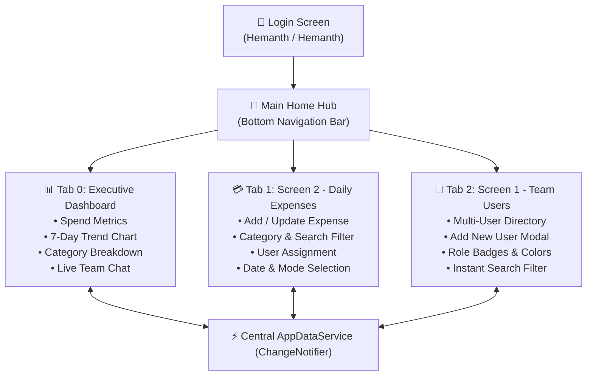

# Project Report: Hemanth Expense & Multi-User Mobile Application

**Author / Lead Engineer:** Hemanthkumar N  
**Technology Stack:** Flutter 3.41.2 • Dart 3.11.0 • Material 3 • Glassmorphism UI  
**Application Type:** Cross-Platform Mobile Application (Android, Web & Windows Desktop)  
**Location:** [`flutter_hemanth_app/`](file:///C:/Users/User-02/.gemini/antigravity-ide/scratch/flutter_hemanth_app)  
**Deliverable Archive:** [`Hemanth_Flutter_Mobile_App.zip`](file:///C:/Users/User-02/Pictures/Hemanth_Flutter_Mobile_App.zip)  

---

## 1. Executive Summary

The **Hemanth Expense & Multi-User Mobile Application** is a production-grade enterprise expense tracking and team collaboration mobile application developed for **Hemanthkumar N** (Full Stack Software Engineer). 

The application incorporates strict authenticated access, centralized state management, daily expense logging with category breakdowns, multi-user assignment, custom data visualization charts, and a real-time team discussion stream.



---

## 2. Core Functional Requirements & Implementation

### 2.1 Authentication & Security (`LoginScreen`)
- **File:** [`login_screen.dart`](file:///C:/Users/User-02/.gemini/antigravity-ide/scratch/flutter_hemanth_app/lib/screens/login_screen.dart)
- **Credential Validation:**
  - **Username:** `Hemanth`
  - **Password:** `Hemanth`
- **Features:**
  - Form validation with reactive error badges.
  - Password visibility toggle (obscure / reveal).
  - "Remember Login Session" preference switch.
  - "Quick Fill Credentials" helper chip for rapid testing.
  - Seamless animated transition to the main dashboard.

---

### 2.2 Screen 1: Multi-User Add & Management (`UserManagementScreen`)
- **File:** [`user_management_screen.dart`](file:///C:/Users/User-02/.gemini/antigravity-ide/scratch/flutter_hemanth_app/lib/screens/user_management_screen.dart)
- **Model:** [`user_model.dart`](file:///C:/Users/User-02/.gemini/antigravity-ide/scratch/flutter_hemanth_app/lib/models/user_model.dart)
- **Capabilities:**
  - **Multi-User Directory:** Displays user cards with colored initial avatars, full names, roles, emails, phone numbers, and join dates.
  - **"+ Add New User" Modal:**
    - Full Name input
    - Username input
    - Email address (`TextInputType.emailAddress`)
    - Phone number (`TextInputType.phone`)
    - Role picker (*Admin / Lead, Engineering Member, Finance Manager, Operations Lead, Product Designer, QA Lead*)
    - Custom Avatar Palette picker (Indigo, Cyan, Emerald, Amber, Pink, Purple).
  - **Search & Filter:** Real-time search by user name, username, or role.
  - **Deletion Protection:** Prevents deleting the primary logged-in administrator (`Hemanth`).

---

### 2.3 Screen 2: Daily Expense Management (`ExpenseScreen`)
- **File:** [`expense_screen.dart`](file:///C:/Users/User-02/.gemini/antigravity-ide/scratch/flutter_hemanth_app/lib/screens/expense_screen.dart)
- **Model:** [`expense_model.dart`](file:///C:/Users/User-02/.gemini/antigravity-ide/scratch/flutter_hemanth_app/lib/models/expense_model.dart)
- **Capabilities:**
  - **Daily Expense Log:** Formatted currency (₹), categorized icons, timestamps, payment badges, and notes.
  - **Update Daily Expense (✏️):** Tap the edit icon on any card to update amount, title, category, date, or notes in place.
  - **"+ Add Expense" Modal:**
    - Title & Description
    - Amount field with decimal input (`TextInputType.numberWithOptions(decimal: true)`)
    - Multi-User Assignment dropdown (links expense to any member from Screen 1)
    - Category selection chips (*Cloud & Software, Food & Dining, Travel & Transport, Hardware & Equipment, Utilities & Bills, Office & Supplies*)
    - Payment Method selector (*UPI, Credit Card, Net Banking, Cash*)
    - Interactive Date & Time Picker
  - **Search & Quick Filter:** Real-time filter by category tags or title search.
  - **Delete Action:** Expense removal with safety confirmation dialog.

---

### 2.4 Executive Dashboard with Analytics Chart & Team Chat (`HomeScreen`)
- **File:** [`home_screen.dart`](file:///C:/Users/User-02/.gemini/antigravity-ide/scratch/flutter_hemanth_app/lib/screens/home_screen.dart)
- **Chart Widget:** [`expense_chart.dart`](file:///C:/Users/User-02/.gemini/antigravity-ide/scratch/flutter_hemanth_app/lib/widgets/expense_chart.dart)
- **Chat Model:** [`chat_model.dart`](file:///C:/Users/User-02/.gemini/antigravity-ide/scratch/flutter_hemanth_app/lib/models/chat_model.dart)
- **Dashboard Sections:**
  1. **User Profile Header:** Active session badge, role title, and avatar.
  2. **Executive Metric Cards:**
     - **Total Spending:** Aggregate sum across all logged expenses.
     - **Today's Expense:** Filtered sum of expenses logged on the current date.
     - **Multi-Users:** Real-time team count.
  3. **Visual Expense Chart:**
     - **Weekly Spend Bar Chart:** 7-day spending trends with highlighted bar for today's volume.
     - **Category Breakdown Progress Bars:** Colored proportional progress bars indicating expenditure distribution.
  4. **Team Expense Chat & Activity Feed:**
     - Interactive discussion stream embedded directly on the dashboard.
     - Live message input box for bill approvals, receipt reminders, and expense notes.
     - Displays sender avatar, role pill, formatted timestamp, and message body.

---

## 3. Architecture & State Management

The application is structured using modular Layered Architecture with the `ChangeNotifier` Observer pattern:

| Layer | Directory | Description |
| :--- | :--- | :--- |
| **Constants** | [`lib/constants/`](file:///C:/Users/User-02/.gemini/antigravity-ide/scratch/flutter_hemanth_app/lib/constants) | Dark obsidian palette (`#070A10`), gradients, and typography |
| **Models** | [`lib/models/`](file:///C:/Users/User-02/.gemini/antigravity-ide/scratch/flutter_hemanth_app/lib/models) | `UserModel`, `ExpenseModel`, `ChatMessageModel` |
| **Services** | [`lib/services/`](file:///C:/Users/User-02/.gemini/antigravity-ide/scratch/flutter_hemanth_app/lib/services) | `AppDataService` singleton with listener broadcasts |
| **Widgets** | [`lib/widgets/`](file:///C:/Users/User-02/.gemini/antigravity-ide/scratch/flutter_hemanth_app/lib/widgets) | `GlassCard`, `CustomButton`, `CustomTextField`, `ExpenseChartWidget` |
| **Screens** | [`lib/screens/`](file:///C:/Users/User-02/.gemini/antigravity-ide/scratch/flutter_hemanth_app/lib/screens) | `LoginScreen`, `HomeScreen`, `ExpenseScreen`, `UserManagementScreen` |

---

## 4. Key Issues Resolved During Development

1. **Flutter SDK Path Registration:**
   - *Problem:* `The term 'flutter' is not recognized`.
   - *Fix:* Executed Windows Registry update script to append `C:\Hemanth\android\src\flutter_windows_3.41.2-stable\flutter\bin` to the user `PATH` environment variable.
2. **KeyboardType Typo in Expense Screen:**
   - *Problem:* `Error: The getter 'TextInputFormat' isn't defined for the type '_ExpenseScreenState'`.
   - *Fix:* Corrected line 145 of [`expense_screen.dart`](file:///C:/Users/User-02/.gemini/antigravity-ide/scratch/flutter_hemanth_app/lib/screens/expense_screen.dart#L145) from `TextInputFormat.number` to `const TextInputType.numberWithOptions(decimal: true)`.

---

## 5. Verification & How to Run

### Command-Line Execution
Run the application on Chrome, Windows, or an Android emulator:

```powershell
# 1. Navigate to the project root
cd C:\Users\User-02\.gemini\antigravity-ide\scratch\flutter_hemanth_app

# 2. Launch in Google Chrome
flutter run -d chrome

# 3. Or launch as Windows Desktop application
flutter run -d windows
```

### Test Credentials
| Field | Value |
| :--- | :--- |
| **Username** | `Hemanth` |
| **Password** | `Hemanth` |

---

## 6. Project Artifacts

- **Source Code Root:** [`flutter_hemanth_app/`](file:///C:/Users/User-02/.gemini/antigravity-ide/scratch/flutter_hemanth_app)
- **Application Archive:** [`Hemanth_Flutter_Mobile_App.zip`](file:///C:/Users/User-02/Pictures/Hemanth_Flutter_Mobile_App.zip)
